# The Great Switch: Europe's car industry and the electric transition

**An end-to-end analysis of Europe's car market and industry (2013–2026), with a country-by-country comparison of petrol and electric cars on running cost and lifecycle CO₂ across all 27 EU member states.**

**[▶ Live interactive report](https://europe-car-transition.vercel.app)** · Data: Eurostat · Comext · EU Weekly Oil Bulletin · Ember · Stack: Python · DuckDB SQL · NumPy Monte Carlo · vanilla JS/SVG

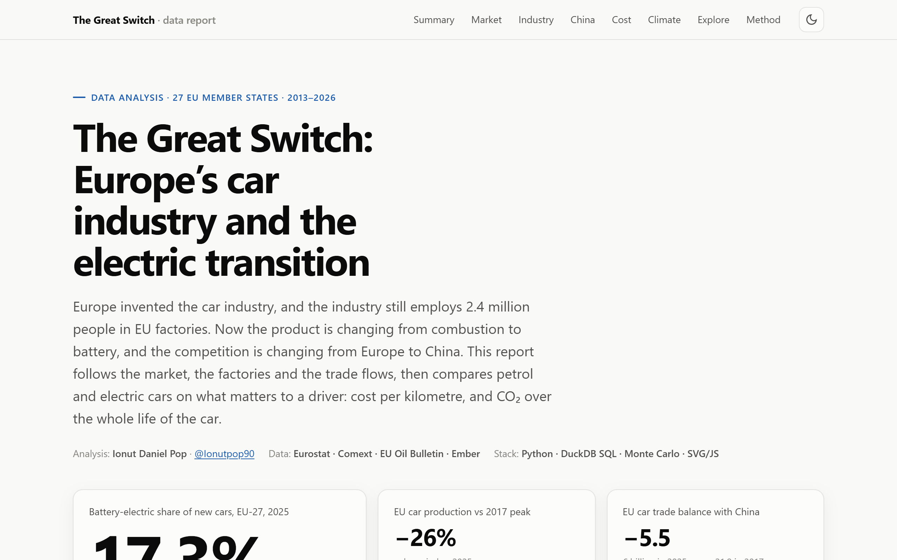

---

## Questions

1. **Market:** How fast is Europe switching from combustion to electric cars, and where?
2. **Industry:** What is happening to car production and jobs, and which economies are most exposed?
3. **China:** How has the car trade between the EU and China changed, and what did the 2024 EU duties do?
4. **Drivers:** Is an electric car cheaper to run than a petrol car, in every country?
5. **Climate:** Does an electric car emit less CO₂ over its whole life, including the battery, even on a coal-heavy grid?

## Key findings

| # | Finding | Evidence |
|---|---|---|
| 1 | **Electric reached one new car in six, unevenly.** | BEV share of EU registrations **0.4% (2015) → 17.3% (2025)**. Denmark is at 67.8%, Croatia at 1.9%. Full hybrids (33.1%) are now the most common powertrain, and diesel fell from 20.0% to 9.8% in four years. The fleet is still only **2.9%** electric. |
| 2 | **The industry is shrinking.** | EU car production volume is **−26% vs 2017**. Italy is at −49%. The sector employs **2.4 million** people, 8% of EU manufacturing jobs, and 15.8% in Slovakia and 14.6% in Romania. |
| 3 | **Builders are not buyers.** | The more a country depends on car manufacturing, the *fewer* electric cars it buys (r = −0.20). Slovakia, Romania and Czechia all sell under 6% electric. |
| 4 | **The China trade flipped.** | EU car exports to China fell **€24.6bn (2022) → €8.4bn (2025)**, and imports rose to €13.8bn. That is a **€5.5bn deficit**, from a €21.9bn surplus in 2017. After the October 2024 anti-subsidy duties on Chinese BEVs, BEV imports fell (€11.0bn → €6.4bn) while **plug-in hybrid imports tripled** (€1.1bn → €3.6bn), a likely substitution into an untaxed category. |
| 5 | **Electric is cheaper to run in every EU country, if charged at home.** | EU average **€5.10 vs €13.06 per 100 km**, a saving of about **€1,195 a year** at 15,000 km (fuel prices of 12 Oct 2026). At a €0.60/kWh public fast charger, an EV costs about €10.80/100 km, close to petrol in Poland, Bulgaria and Malta. |
| 6 | **Electric emits less CO₂ over its life in all 27 countries.** | EU grid: **97 vs 217 g CO₂e/km (−55%)**. The battery's extra footprint is repaid after **26,000 km (Sweden) to 65,000 km (Poland)**. In 10,000 Monte Carlo draws, the EV wins in **≥99.9%** of cases in every country, Poland included (median −21%). |

## Visuals

| Powertrain mix | Electric share by country |
|---|---|
| 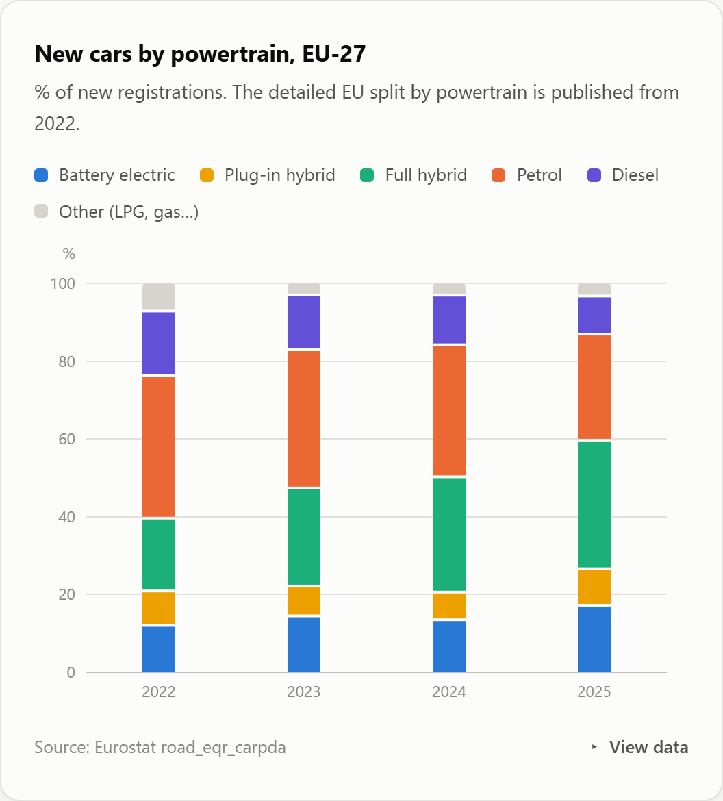 | 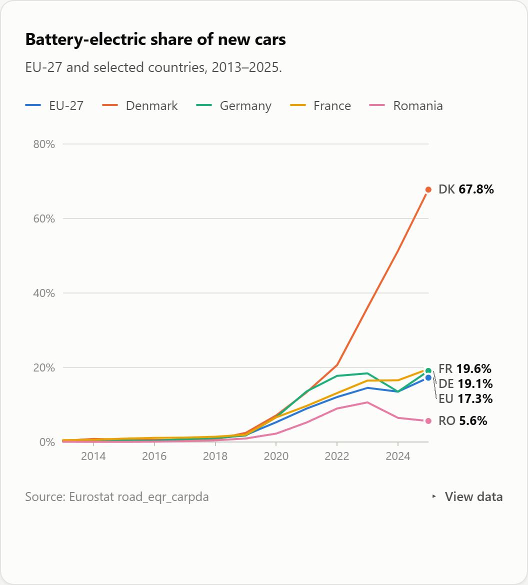 |
| **Production index** | **Builders vs buyers** |
| 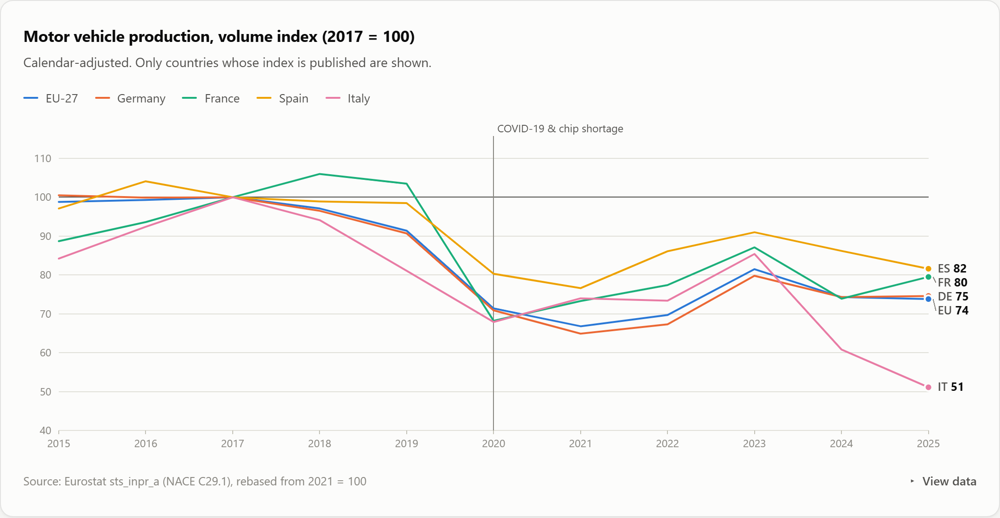 | 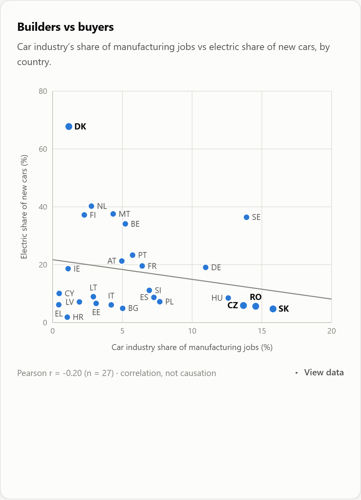 |
| **EU–China car trade** | **Imports from China by powertrain** |
| 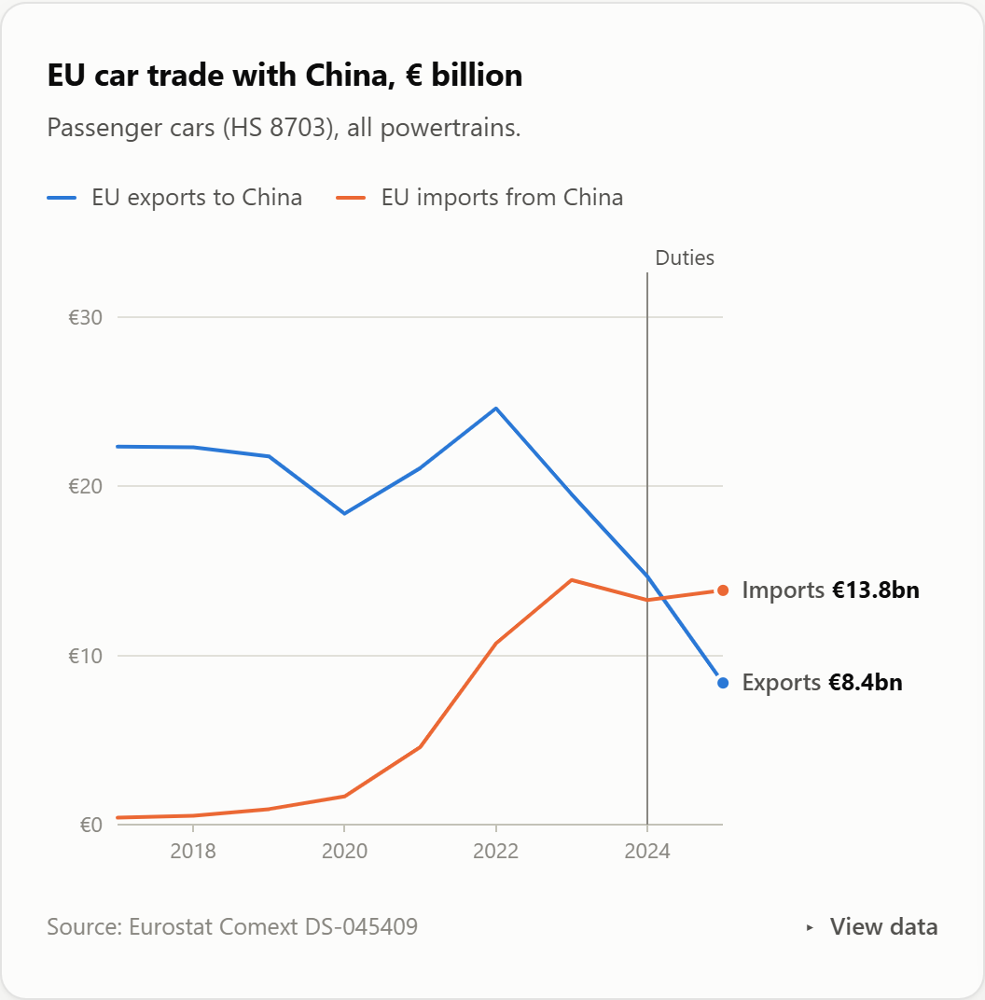 | 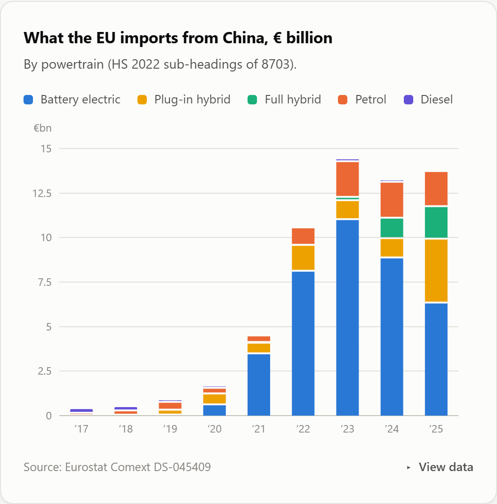 |
| **Cost per 100 km by country** | **Lifecycle CO₂, EU grid** |
| 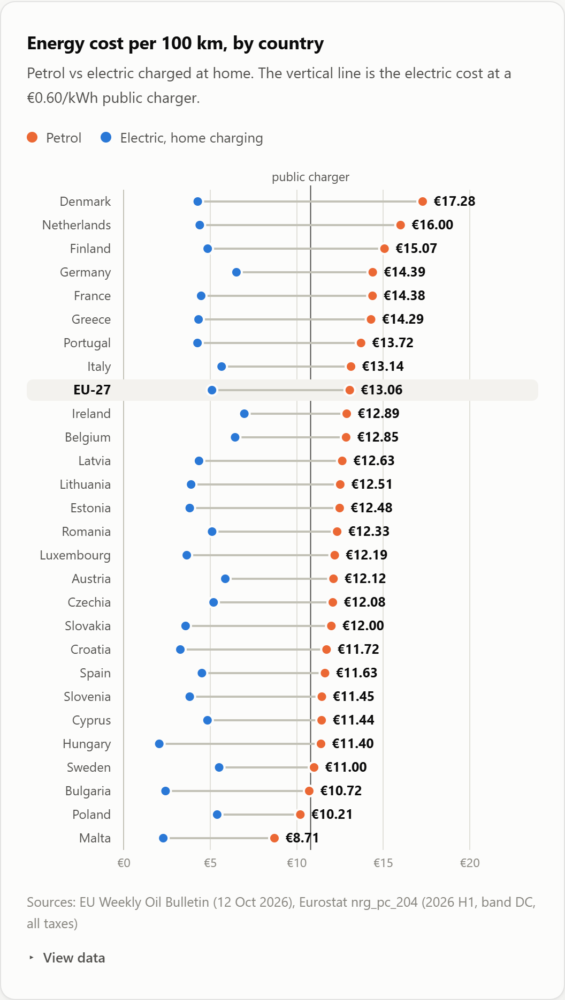 | 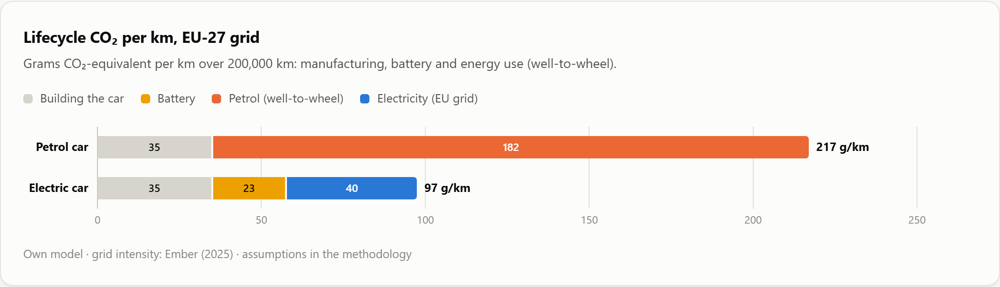 |
| **CO₂ saving with 90% intervals** | **Sensitivity (tornado)** |
| 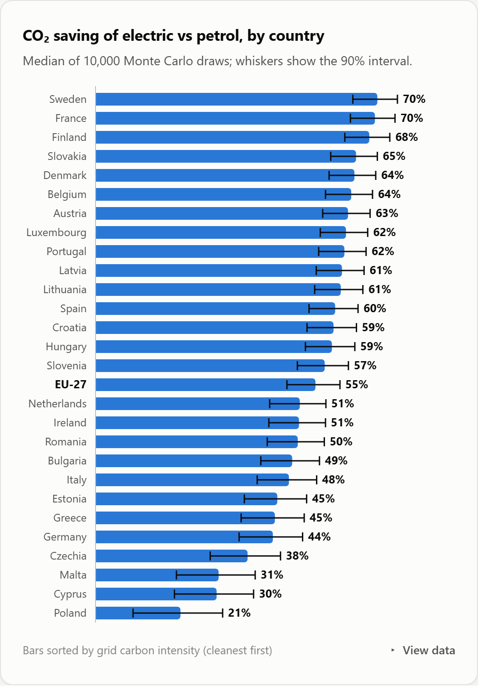 | 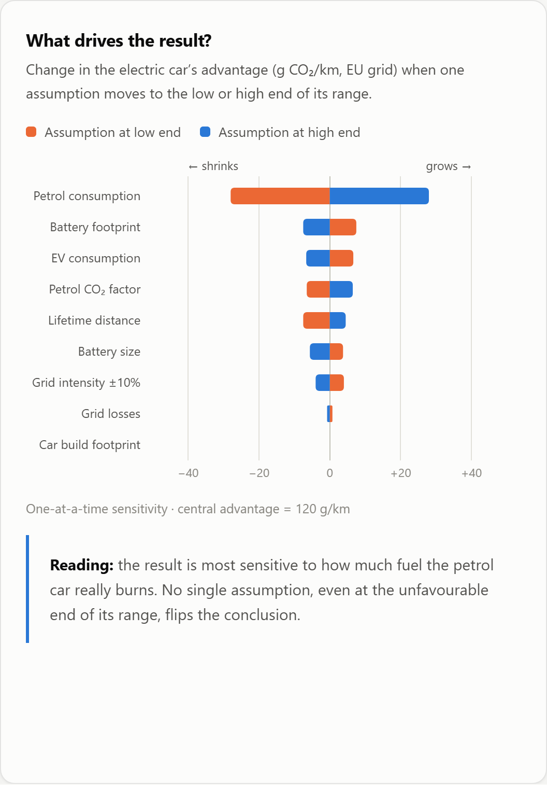 |

There is also an interactive map with 8 indicators. Every chart has a tooltip and a data table, and the report works in light and dark mode and on mobile. Powertrain colours are fixed per entity (electric is always blue, petrol always orange) and were validated for colour-vision deficiency.

## Method

```
Eurostat API ──┐
Comext API ────┤
Oil Bulletin ──┼─► data/raw ─► DuckDB ─► sql/01_staging.sql (+ dim_assumption table)
Ember CSV ─────┘                         sql/02_marts.sql   (mix · industry · trade · costs · lifecycle)
                                                  │
                     src/build_dataset.py ◄───────┘  Monte Carlo (10,000 draws) + tornado ─► report/data.json
```

**Lifecycle model (per km, over the car's life).**
- Petrol car: `build / lifetime_km + L/100km × kg CO₂e/L (well-to-wheel)`.
- Electric car: `(build + battery_kWh × kg CO₂e/kWh) / lifetime_km + kWh/100km × grid g/kWh × grid losses`.
- Break-even distance: `battery footprint ÷ per-km saving`.

**Uncertainty.** Every assumption has a central value and a range (in [`sql/01_staging.sql`](sql/01_staging.sql)). The Monte Carlo draws each one from a triangular distribution and adds ±10% noise to grid intensity. The tornado varies one assumption at a time. The conclusion is most sensitive to the petrol car's real-world consumption, and no single assumption flips it.

| Assumption | Central | Range |
|---|---|---|
| Petrol consumption | 6.5 L/100 km | 5.5–7.5 |
| EV consumption at the plug | 18 kWh/100 km | 15–21 |
| Petrol well-to-wheel | 2.80 kg CO₂e/L | 2.70–2.90 |
| Battery | 60 kWh × 75 kg CO₂e/kWh | 50–75 kWh × 50–100 kg/kWh |
| Car build (excl. battery) | 7.0 t CO₂e | 6–8 |
| Lifetime | 200,000 km | 150,000–250,000 |

### Data issues handled

- **Quarterly production and permits are confidential** for most countries. Annual indices are used and only published series are shown (6 countries + EU).
- **Comext HS codes** changed in 2017 (HS 2017) and 2022 (HS 2022). Trade is mapped to powertrains at HS6 level from 2017.
- **Oil Bulletin**: the wide Excel sheet (one column block per country) is reshaped to long format. The EU value is the bulletin's own consumption-weighted average.
- **Ember** has no ISO code for the EU aggregate. It is mapped explicitly.

## Reproduce

```bash
pip install -r requirements.txt
python src/fetch_data.py         # Eurostat, Comext, Oil Bulletin, Ember (about 3 min, 50 MB)
python src/build_dataset.py      # SQL models + Monte Carlo -> report/data.json
python -m http.server -d report  # open http://localhost:8000
```

## Limitations

- Running cost covers energy only. Purchase price, maintenance, insurance and resale value are not in official statistics.
- Ember's intensity is direct generation emissions, not full power-plant lifecycle. Using today's grid for the whole car life is conservative, because grids are decarbonising.
- The public charging tariff (€0.60/kWh) is a stated scenario, not measured data.
- Cross-country correlations (n = 27) describe patterns, not causes.

---

*Author: **Ionut Daniel Pop** · GitHub [@Ionutpop90](https://github.com/Ionutpop90) · Other projects: [Europe health check](https://github.com/Ionutpop90/europe-health-check) · [Europe housing affordability](https://github.com/Ionutpop90/europe-housing-affordability) · [Romania vs EU inflation](https://github.com/Ionutpop90/romania-inflation-analysis)*
